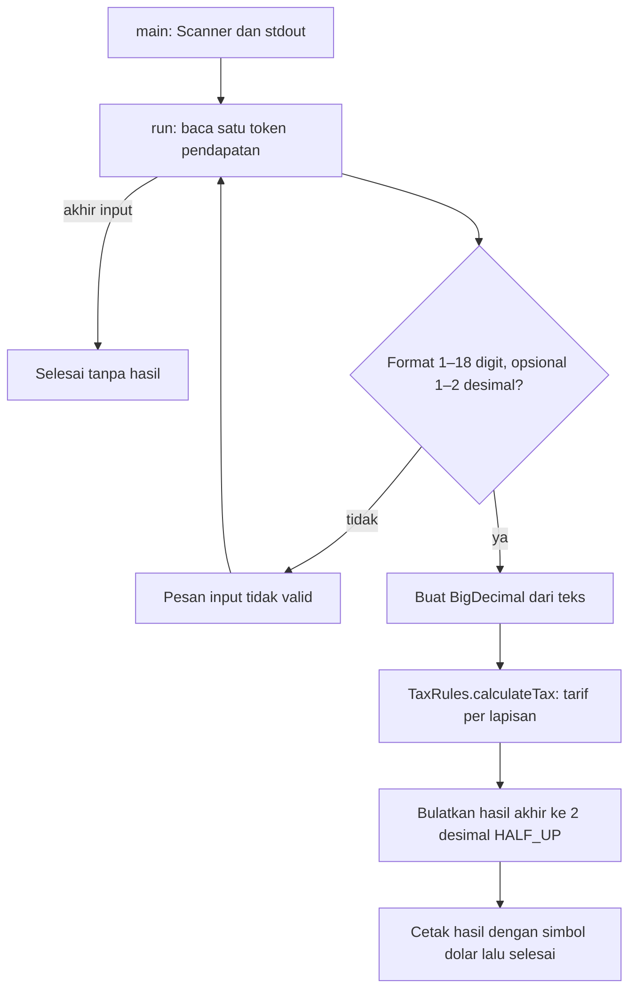

# Alur kode Tax Calculator

Program menghitung satu nilai pendapatan menggunakan tiga lapisan tarif latihan dalam source. Tarif ini tidak merujuk aturan pajak negara atau tahun tertentu.

| Bagian | Sumber |
| --- | --- |
| Prompt, format input dan pembulatan keluaran | [TaxCalculator.java](../src/taxcalculator/TaxCalculator.java) |
| Rumus progresif desimal | [TaxRules.java](../src/taxcalculator/TaxRules.java) |
| Tes batas dan hasil perhitungan | [TaxRulesTest.java](../test/taxcalculator/TaxRulesTest.java) |
| Tes input konsol dan adapter | [TaxCalculatorTest.java](../test/taxcalculator/TaxCalculatorTest.java) |

`TaxCalculator.run()` menerima input/output sebagai parameter agar dapat diuji tanpa mengganti stream global. Input dipisahkan spasi atau baris baru. Regex hanya menerima digit nonnegatif, maksimal 18 digit bagian bulat, dan pecahan opsional dengan titik. Koma, tanda plus/minus, notasi ilmiah, serta pecahan lebih panjang ditolak sebelum `BigDecimal` dibuat. Input salah meminta ulang; EOF tidak mencetak nilai yang belum dihitung.

`TaxRules.calculateTax()` menolak `null` dan nilai negatif. Pendapatan sampai 50.000 dikalikan 5%. Bagian di atas 50.000 sampai 100.000 dikenai 10%, setelah pajak lapisan pertama sebesar 2.500. Bagian di atas 100.000 dikenai 15%, setelah dua lapisan pertama sebesar 7.500. Semua konstanta dibuat dari string desimal, sehingga rumus tidak melewati representasi biner `double`.

Helper `TaxRules` mengembalikan hasil eksak tanpa pembulatan. Konsol baru memanggil `setScale(2, HALF_UP)` pada hasil akhir dan `toPlainString()` untuk mencetaknya. Contoh pendapatan `0.10` menghasilkan pajak eksak `0.005`, ditampilkan `0.01`. Batas digit konsol tidak membatasi pemanggilan langsung helper dengan `BigDecimal`.

API lama `TaxCalculator.calculateTax(double)` tetap menjadi adapter. Ia menolak nilai negatif, NaN dan infinity, memanggil aturan yang sama melalui `BigDecimal.valueOf()`, lalu mengembalikan `double` tanpa pembulatan dua desimal. Gunakan helper desimal bila pemanggil membutuhkan hasil eksak.

Program selesai setelah satu perhitungan berhasil. Tidak ada akun, koneksi jaringan, database atau penyimpanan hasil otomatis. [README](../README.md) menjelaskan build dan tes mandiri. Perubahan dokumen ini tidak mengubah tarif, perilaku input atau screenshot yang sudah tersedia.
